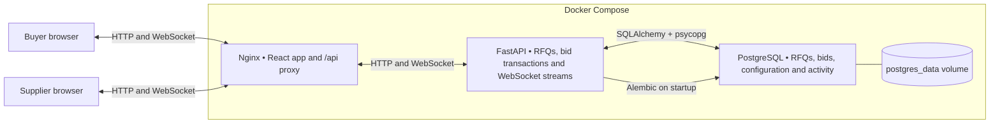

# BidVerse high-level design

BidVerse lets buyers create freight RFQs and suppliers submit and revise quotes in a British Auction. The server controls the bidding period, ranks quotes, and records every accepted bid and extension.

## Architecture

- React Router provides the auction list, RFQ creation, and auction details. Axios calls the same-origin `/api` path. TanStack Query caches API data and refreshes it on demand, after writes, and when it receives an auction update. Host development uses the Vite proxy in place of Nginx.
- FastAPI validates request bodies with Pydantic, verifies buyer and supplier roles, and calculates status using server UTC time. SQLAlchemy manages PostgreSQL transactions. Docker Compose waits for PostgreSQL before running Alembic and starting the API.
- The API publishes a WebSocket notification only after a bid commits. Subscribers to that RFQ refetch the current deadline, rankings, bid history, and activity. Clients reconnect and poll during connection failures. The local API runs one Uvicorn worker with in-process subscriptions.

## Bid submission

1. Lock the RFQ row with `SELECT FOR UPDATE`. Read server time after the lock is acquired and accept bids in `[bid_start_at, current_close_at)` for an auction-enabled RFQ. Quote validity must be later than submission. A revision must lower the supplier’s last accepted total for that RFQ, including when the previous bid has expired.
2. Add a bid row and a `bid_submitted` activity entry. PostgreSQL calculates the total from the three charges. Ranking uses the latest unexpired bid per supplier, then sorts by total, submission timestamp, and bid ID, all ascending.
3. For bids in the last X minutes, evaluate the configured trigger. Rank triggers compare supplier order before and after the same bid at the same timestamp. On a match, set `current_close_at = min(current_close_at + Y minutes, forced_close_at)` and add a `time_extended` entry with both deadlines and the trigger.
4. Commit the bid, deadline, and activities together. Send the update to the RFQ’s WebSocket subscribers. Read endpoints compute status from the saved deadline and server time, including at the closing instant.

## Database schema

See [Schema Design.md](Schema%20Design.md) for the database tables, relationships, and constraints.

## Assignment review

Sections 5–8 specify the auction behavior. Section 9 lists the four deliverables. [Original assignment PDF](%5BAssignment%5D%20British%20Auction%20in%20RFQ%20System%20%281%29.pdf)

| Assignment section | Coverage |
|---|---|
| §5 and §7 — RFQ and quote fields, validation | The creation form has the schedule, service date, and British Auction settings. The quote form captures carrier, charges, transit days, and validity. The API checks the ordering of deadlines and rejects bids at or after close. |
| §6 — X/Y and trigger options | All three triggers are implemented. The window follows the current deadline and each extension is capped at forced close. |
| §8 — Listing and details | The listing shows RFQ name/reference, lowest valid total, current and forced closing times, and status. Details include ranked suppliers, all bid revisions sorted by price, quote details, configuration, and the activity timeline with extension reasons. Scheduled auctions add an `Upcoming` status. |
| §9 — Submission | This document supplies the HLD and architecture diagram. [Schema Design.md](Schema%20Design.md) documents the database tables. `backend/` and `frontend/` contain the implementation. |

### Interpretations and remaining scope

- The app ranks the latest unexpired bid from each supplier. Ties favor the earlier bid. Validity expiry can change the displayed ranking, including after close.
- A rank change means an existing supplier moves to a different position. A supplier entering in last place, the first bid, and expiry by itself leave the deadline unchanged for rank-based triggers. The first bid can extend an auction with the any-bid trigger.
- The demo uses seeded buyer and supplier selection. Authentication, supplier invitations, quote award, comparative reporting for the success metrics, and bidding for RFQs without British Auction are outside the implemented scope. The assignment describes some of these as background or business outcomes and gives no workflow for them.
