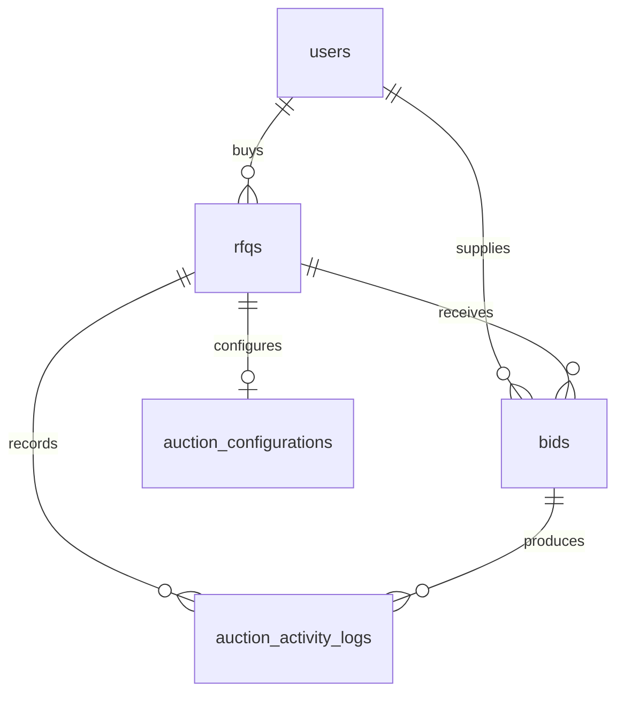

# Schema Design

| Table | Columns and constraints |
|---|---|
| `users` | Integer `id` primary key. `name` (`varchar(120)`), unique `email` (`varchar(254)`), `role` (`buyer` or `supplier`), and `created_at`. |
| `rfqs` | Integer `id` primary key and `buyer_id` foreign key to `users`. Unique `reference_id` (`varchar(64)`), `name` (`varchar(160)`), three-letter `currency`, `service_date` (`date`), `bid_start_at`, `original_close_at`, `current_close_at`, `forced_close_at`, and `created_at`. The database enforces `start < original < forced` and `original <= current <= forced`. |
| `auction_configurations` | `rfq_id` is both primary key and foreign key to `rfqs`. Both `trigger_window_minutes` and `extension_minutes` are positive integers. `extension_trigger` is one of `bid_received`, `supplier_rank_changed`, or `lowest_bidder_changed`. An RFQ can have zero or one configuration. |
| `bids` | Integer `id` primary key, `rfq_id` and `supplier_id` foreign keys, `carrier_name` (`varchar(160)`), nonnegative `freight_charge`, `origin_charge`, and `destination_charge` (`numeric(12,2)` each), generated `total_price` (`numeric(13,2)`), nonnegative `transit_time_days`, `valid_until`, and `submitted_at`. Validity follows submission. A unique `(rfq_id, id)` pair supports the activity foreign key. Each revision gets its own row. |
| `auction_activity_logs` | Integer `id` primary key, `rfq_id` foreign key, composite `(rfq_id, bid_id)` foreign key to the bid on the same RFQ, `event_type` (`bid_submitted` or `time_extended`), and `occurred_at`. `extension_trigger`, `previous_close_at`, and `new_close_at` are populated only for extensions. Extensions require `previous_close_at < new_close_at`. `(bid_id, event_type)` is unique. |

Event and deadline timestamps use `timestamptz`. The API serializes them in UTC. Foreign keys restrict deletion of referenced rows. Indexes cover RFQs by buyer and current deadline, bid history by RFQ and price, latest quotes by RFQ and supplier, the supplier foreign key, and activity in RFQ timeline order. [SQLAlchemy models](backend/app/models.py) · [Alembic migration](backend/alembic/versions/93f92ff58a26_create_rfq_auction_schema.py)
